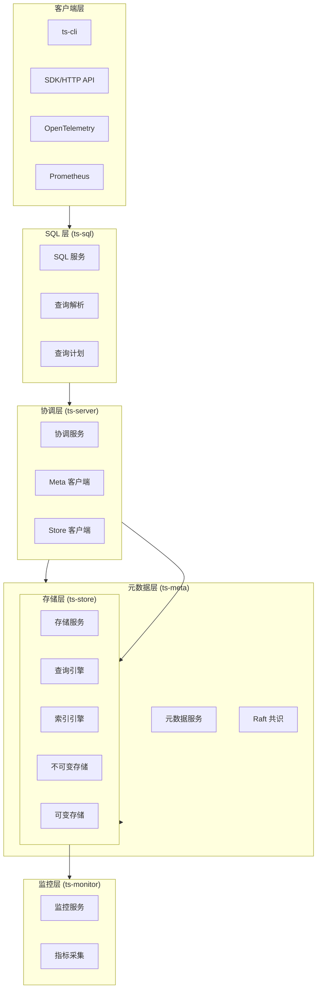
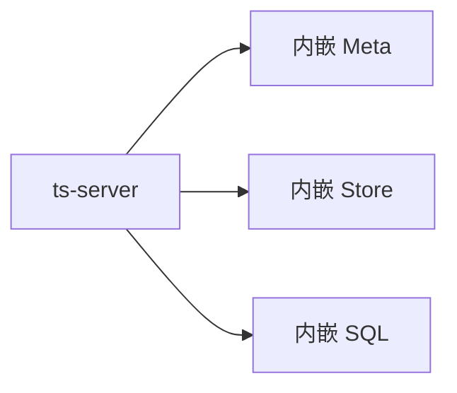
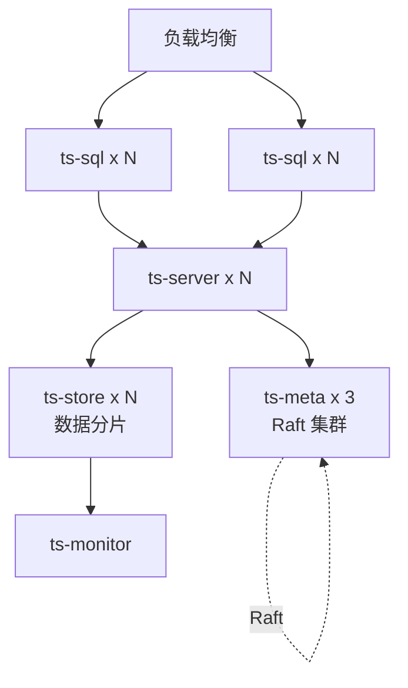
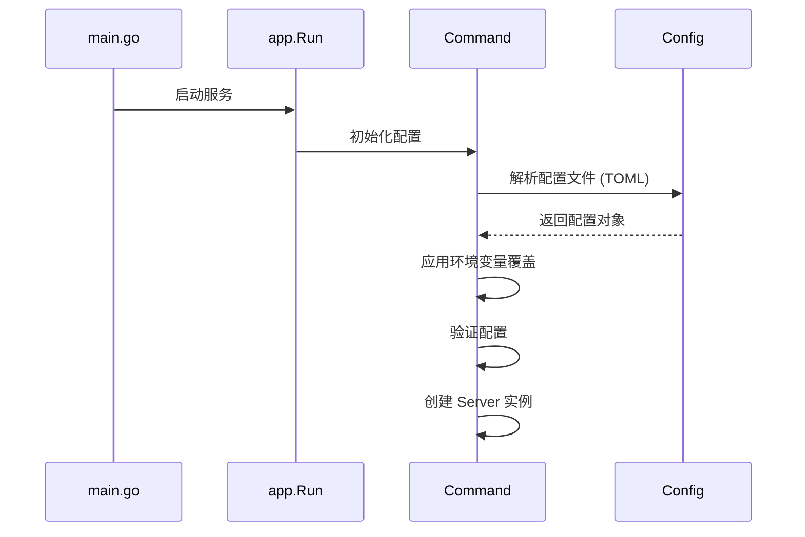
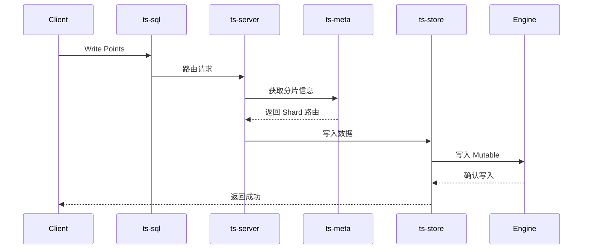
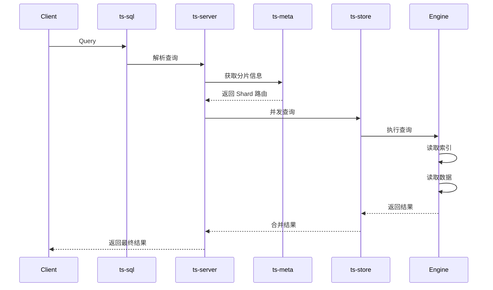

# openGemini 架构概览

**代码版本**: 7032447bce3ec6d35eb204a0f317882298b774b5 (2026-05-15)

本文档详细描述 openGemini 时序数据库的整体架构、模块划分和核心组件。

---

## 1. 项目概述

### 1.1 基本信息

| 项目 | 说明 |
|------|------|
| 名称 | openGemini |
| 类型 | 云原生分布式时序数据库 |
| 语言 | Go 1.22+ |
| 许可证 | Apache 2.0 |
| 状态 | CNCF Sandbox 项目 |
| 兼容性 | InfluxDB v1.x 协议/API |

### 1.2 核心特性

- **高性能**: LSM 树存储、自动分区、列式存储
- **高扩展性**: MPP 架构、分布式集群部署
- **高基数**: 专用高基数存储引擎
- **高压缩**: 数据压缩比高达 15:1
- **云原生**: 支持容器化、K8s Operator、OpenTelemetry、Prometheus

---

## 2. 系统架构

### 2.1 整体架构图



### 2.2 部署模式

#### 2.2.1 单机模式 (ts-server)



**特点**:
- 单进程包含所有组件
- 适合开发和测试
- 配置文件：`config/openGemini.singlenode.conf`

#### 2.2.2 分布式集群



**组件说明**:
- **ts-meta (3 节点)**: 元数据管理，Raft 保证一致性
- **ts-store**: 数据存储，可水平扩展
- **ts-sql**: SQL 查询服务，无状态可水平扩展
- **ts-server**: 单机部署时的综合节点
- **ts-monitor**: 监控指标采集

---

## 3. 核心二进制文件

### 3.1 概览

| 二进制文件 | 端口 | 功能 | 配置文件 |
|-----------|------|------|----------|
| ts-meta | 8088/8091/8092 | 元数据服务 | `[meta]` |
| ts-store | 8086/8088 | 数据存储 | `[store]` |
| ts-sql | 8086 | SQL 查询 | `[sql]` |
| ts-server | 8086/8088/8091/8092 | 综合节点 | `[single]` |
| ts-monitor | 8086 | 监控采集 | `[monitor]` |
| ts-data | - | 数据工具 | - |
| ts-recover | - | 数据恢复 | - |

### 3.2 启动入口分析

所有服务遵循统一的启动模式：

```go
// 典型入口：app/ts-store/main.go
func main() {
    app.InitParse()                    // 初始化命令行解析
    errno.SetNode(errno.NodeStore)     // 设置节点类型
    info := app.ServerInfo{...}        // 版本信息
    app.Run(os.Args[1:], run.NewCommand(info, true))
}
```

#### 3.2.1 ts-server 特殊处理

```go
// app/ts-server/main.go - 单机模式
func main() {
    app.InitParse()
    errno.SetNode(errno.NodeServer)
    info := app.ServerInfo{App: config.AppSingle, ...}
    
    // 创建三个内嵌组件
    cmdMeta := meta.NewCommand(info, false)
    cmdStore := store.NewCommand(info, false)
    cmdSql := ingestserver.NewCommand(info, false)
    
    // 初始化存储依赖
    cmdSql.AfterOpen = func() {
        run.InitStorage(cmdSql.Server, cmdStore.Server)
    }
    
    // 同时运行三个服务
    app.Run(os.Args[1:], cmdMeta, cmdStore, cmdSql)
}
```

### 3.3 应用类型常量

```go
// lib/config/config.go
const (
    AppSql     App = "sql"      // SQL 查询服务
    AppStore   App = "store"    // 存储服务
    AppMeta    App = "meta"     // 元数据服务
    AppSingle  App = "single"   // 单机综合节点
    AppMonitor App = "monitor"  // 监控服务
    AppData    App = "data"     // 数据工具
)
```

---

## 4. 代码目录结构

### 4.1 顶层目录

```
openGemini/
├── app/                    # 应用程序入口
├── engine/                 # 核心查询引擎
├── services/               # 微服务层
├── lib/                    # 公共库 (71 个子模块)
├── config/                 # 配置文件
├── docker/                 # Docker 部署
├── python/                 # Python SDK
├── scripts/                # 脚本工具
├── tests/                  # 测试
└── docs/                   # 文档
```

### 4.2 app/ - 应用程序层

```
app/
├── command.go              # 命令处理核心
├── common.go               # 公共函数和常量
├── server.go               # Server 接口定义
├── operation.go            # 运维操作
├── ts-meta/                # 元数据服务
│   ├── main.go
│   ├── meta/               # Meta 实现
│   └── run/                # 运行逻辑
├── ts-store/               # 存储服务
│   ├── main.go
│   ├── storage/            # 存储实现
│   ├── stream/             # 流处理
│   ├── transport/          # 数据传输
│   └── run/                # 运行逻辑
├── ts-sql/                 # SQL 服务
│   ├── main.go
│   └── sql/                # SQL 实现
├── ts-server/              # 综合节点
│   ├── main.go
│   └── run/                # 运行逻辑
├── ts-monitor/             # 监控服务
│   ├── main.go
│   ├── collector/          # 指标采集
│   └── run/                # 运行逻辑
├── ts-data/                # 数据工具
└── ts-recover/             # 数据恢复
```

### 4.3 engine/ - 查询引擎

```
engine/
├── engine.go               # 引擎主入口
├── engine_interface.go     # 引擎接口
├── engine_ddl.go           # DDL 操作
├── engine_ha.go            # 高可用
├── shard.go                # 分片管理
├── partition.go            # 分区管理
├── wal.go                  # WAL 日志
├── immutable/              # 不可变存储 (TSM 文件)
├── mutable/                # 可变存储 (内存)
├── index/                  # 索引引擎
│   ├── tsi/                # 时间序列索引
│   ├── sparseindex/        # 稀疏索引
│   ├── bloomfilter/        # 布隆过滤器
│   └── ...
├── executor/               # 查询执行器
│   ├── agg_func.go         # 聚合函数
│   ├── agg_iterator.go     # 聚合迭代器
│   ├── chunk.go            # 数据块
│   └── ...
├── optimizer/              # 查询优化器
├── hybridqp/               # 混合查询计划
└── op/                     # 操作符
```

### 4.4 services/ - 微服务层

```
services/
├── arrowflight/            # Arrow Flight 服务
├── castor/                 # 计算服务
├── consume/                # 数据消费
├── continuousquery/        # 连续查询
├── downsample/             # 降采样
├── fence/                  # 数据隔离
├── hierarchical/           # 层级聚合
├── pubsub/                 # 发布订阅
├── retention/              # 数据保留策略
├── runtimecfg/             # 运行时配置
├── series/                 # 序列处理
├── sherlock/               # 智能运维
├── stream/                 # 流处理
└── writer/                 # 写入服务
```

### 4.5 lib/ - 公共库 (71 个模块)

核心模块分类：

| 分类 | 模块 |
|------|------|
| **数据存储** | codec, compress, record, fileops, parquet |
| **索引** | index, bloomfilter, binarysearch |
| **网络** | spdy, raftconn, raftlog, httpserver, proxy |
| **缓存** | cache, bufferpool, pool, lastrowcache, readcache |
| **配置** | config, logger, sysconfig |
| **分布式** | consistenthash, memberlist, topo |
| **监控** | metrics, statisticsPusher, usage_client |
| **工具** | util, crypto, encoding, numberenc, strings |

---

## 5. 配置系统

### 5.1 配置文件结构

```toml
# config/openGemini.conf
[common]                  # 通用配置
  meta-join = [...]       # Meta 节点列表
  cpu-num = 0             # CPU 核心数
  memory-size = "0"       # 内存限制

[meta]                    # Meta 服务配置
  bind-address = ":8088"
  http-bind-address = ":8091"
  rpc-bind-address = ":8092"
  
[store]                   # Store 服务配置
  bind-address = ":8088"
  
[sql]                     # SQL 服务配置
  
[http]                    # HTTP 服务配置
  bind-address = ":8086"
  
[coordinator]             # 协调器配置
  
[retention]               # 数据保留策略
```

### 5.2 配置类型定义

```go
// lib/config/config.go
type Config interface {
    ApplyEnvOverrides(func(string) string) error
    Validate() error
    GetLogging() *Logger
    GetSpdy() *Spdy
    GetCommon() *Common
    ShowConfigs() map[string]interface{}
}
```

### 5.3 配置加载流程



---

## 6. 构建系统

### 6.1 构建脚本

**build.py** - Python 构建脚本:
- 清理构建目录
- 编译 7 个二进制文件
- 支持多平台交叉编译
- 嵌入版本信息

**Makefile** - Make 构建目标:
```makefile
go-build:          # 编译所有目标
style-check:       # 代码风格检查
gotest:            # 运行单元测试
integration-test:  # 集成测试
build-check:       # 多平台构建验证
```

### 6.2 构建目标

```python
# build.py
TARGETS = {
    'ts-sql': './app/ts-sql',
    'ts-meta': './app/ts-meta',
    'ts-store': './app/ts-store',
    'ts-server': './app/ts-server',
    'ts-monitor': './app/ts-monitor',
    'ts-data': './app/ts-data',
    'ts-recover': './app/ts-recover'
}
```

### 6.3 构建输出

```bash
$ ls build/
ts-meta  ts-monitor  ts-server  ts-sql  ts-store  ts-data  ts-recover
```

---

## 7. 数据流架构

### 7.1 写入流程



### 7.2 查询流程



---

## 8. 关键技术选型

### 8.1 存储引擎

| 技术 | 用途 |
|------|------|
| LSM 树 | 数据写入优化 |
| TSM 文件 | 时序数据列式存储 |
| 布隆过滤器 | 加速数据查找 |
| 字典编码 | 数据压缩 |

### 8.2 分布式

| 技术 | 用途 |
|------|------|
| Raft | 元数据一致性 |
| Serf | 节点发现 |
| 一致性哈希 | 数据分片 |
| SPDY | 节点间通信 |

### 8.3 查询处理

| 技术 | 用途 |
|------|------|
| InfluxQL | 查询语言 |
| PromQL | Prometheus 查询 |
| 迭代器模型 | 查询执行 |
| 向量化执行 | 性能优化 |

---

## 9. 核心接口定义

### 9.1 Server 接口

```go
// app/server.go
type Server interface {
    Open() error      // 启动服务
    Close() error     // 关闭服务
    Err() <-chan error // 错误通道
}
```

### 9.2 Service 接口

```go
type Service interface {
    Open() error
    Close() error
}
```

### 9.3 Config 接口

```go
// lib/config/config.go
type Config interface {
    ApplyEnvOverrides(func(string) string) error
    Validate() error
    GetLogging() *Logger
    GetSpdy() *Spdy
    GetCommon() *Common
}
```

---

## 10. 部署架构

### 10.1 容器化部署

```yaml
# Kubernetes Deployment
apiVersion: apps/v1
kind: Deployment
metadata:
  name: openGemini-meta
spec:
  replicas: 3
  template:
    spec:
      containers:
      - name: ts-meta
        image: opengemini/ts-meta:latest
        ports:
        - containerPort: 8088
        - containerPort: 8091
        - containerPort: 8092
```

### 10.2 推荐集群配置

| 组件 | 数量 | 资源配置 |
|------|------|----------|
| ts-meta | 3 | 4C8G |
| ts-store | N | 16C64G+ |
| ts-sql | N | 8C16G |
| ts-monitor | 1 | 4C8G |

---

## 11. 代码验证

### 11.1 验证点

✅ **5 个核心二进制文件**:
- `app/ts-*/main.go` 已确认启动模式一致
- `ts-server` 特殊处理：内嵌 Meta+Store+SQL

✅ **配置系统**:
- `lib/config/config.go` 定义配置接口
- `config/openGemini.conf` 提供配置模板

✅ **目录结构**:
- `app/` - 7 个应用入口
- `engine/` - 查询引擎核心
- `services/` - 微服务层
- `lib/` - 71 个公共库

✅ **构建系统**:
- `build.py` 定义 7 个构建目标
- `Makefile` 提供标准构建命令

### 11.2 代码位置索引

| 组件 | 关键文件 | 行号 |
|------|----------|------|
| 启动入口 | `app/ts-*/main.go` | - |
| 配置定义 | `lib/config/config.go` | 68-83 |
| Server 接口 | `app/server.go` | 26-29 |
| 构建目标 | `build.py` | 29-36 |
| 配置模板 | `config/openGemini.conf` | - |

---

## 12. 下一步分析

完成架构概览后，建议按以下顺序深入分析：

1. **存储引擎** - `engine/engine.go`, `engine/shard.go`
2. **索引系统** - `engine/index/` 目录
3. **查询执行** - `engine/executor/` 目录
4. **分布式** - `lib/raftlog/`, `lib/spdy/`

---

**文档版本**: 1.0  
**创建日期**: 2026-05-15  
**验证状态**: ✅ 已验证代码一致性

---
**最后验证**: 2026-05-15
**验证状态**: ✅ 已修正
**代码版本**: 7032447bce3ec6d35eb204a0f317882298b774b5
