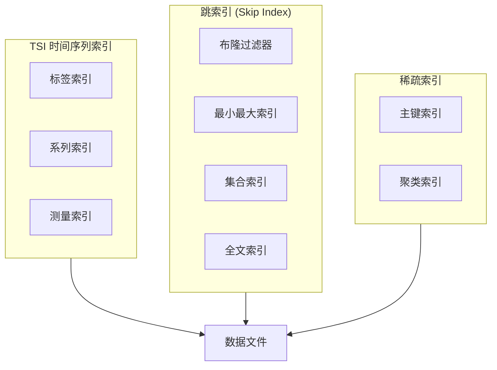
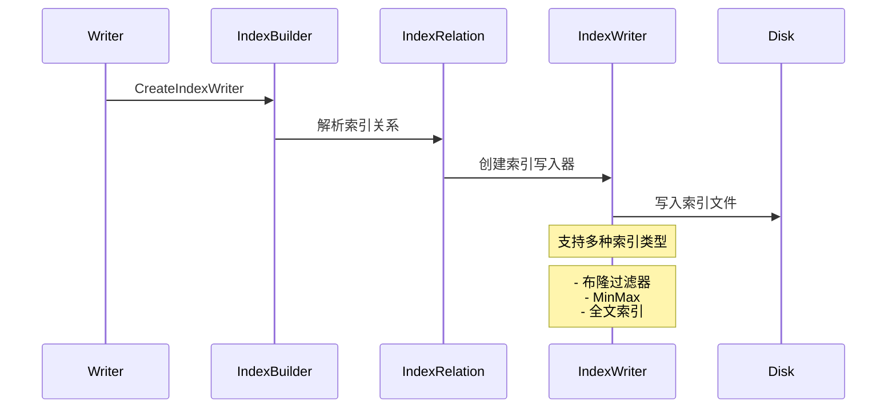
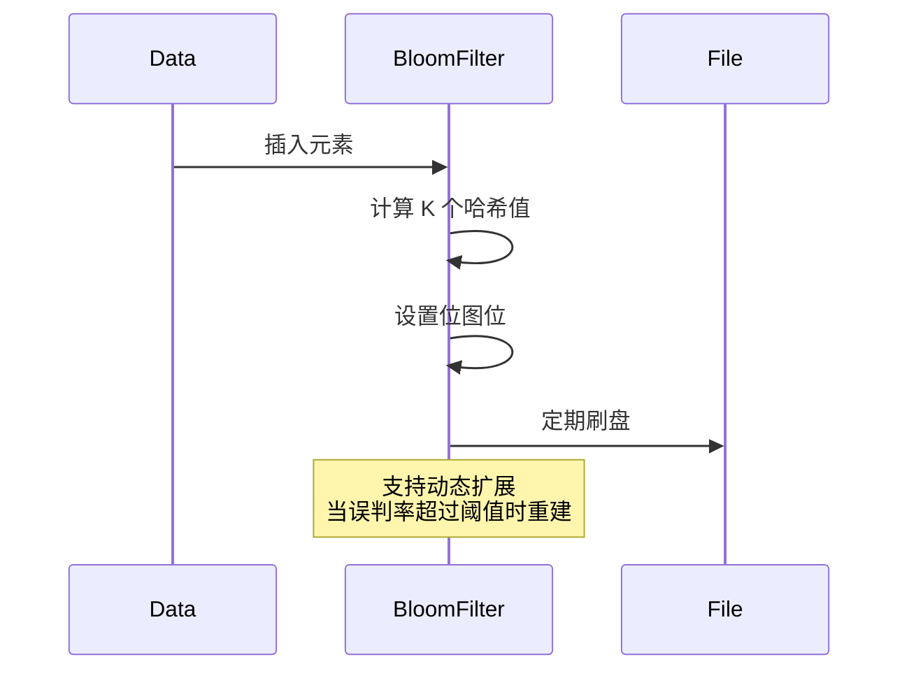
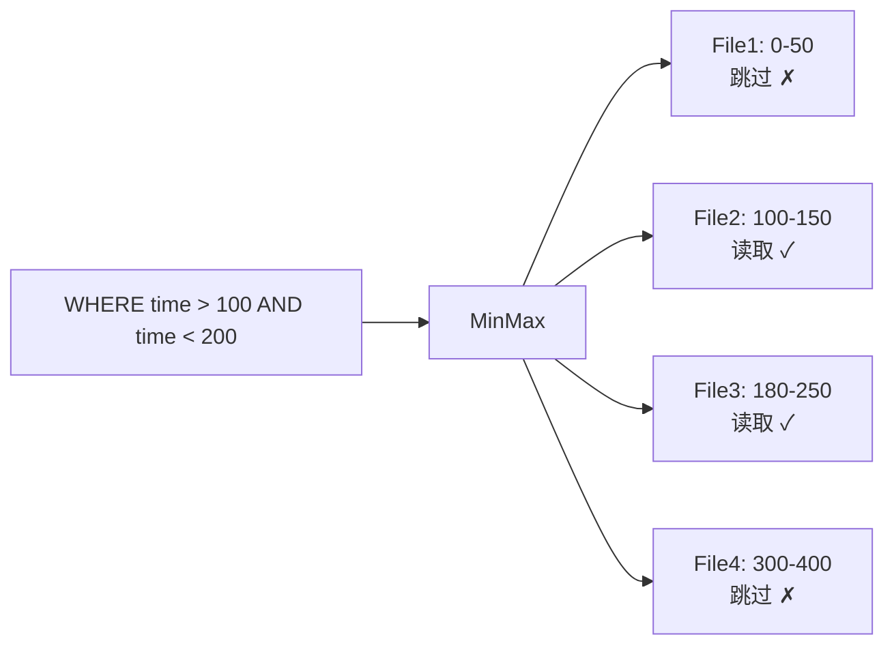

# openGemini 索引系统分析

**代码版本**: 7032447bce3ec6d35eb204a0f317882298b774b5 (2026-05-15)

本文档详细分析 openGemini 的索引系统设计，包括 TSI 时间序列索引、跳表索引、布隆过滤器等。

---

## 1. 索引系统概述

### 1.1 索引架构

openGemini 采用**多层索引架构**，支持多种索引类型：



### 1.2 索引类型

| 索引类型 | 位置 | 用途 | 粒度 |
|----------|------|------|------|
| TSI | `engine/index/tsi/` | 时间序列倒排索引 | Series 级别 |
| 布隆过滤器 | `engine/index/sparseindex/` | 快速存在性判断 | 数据块级别 |
| MinMax 索引 | `engine/index/sparseindex/` | 范围过滤 | 数据块级别 |
| 全文索引 | `engine/index/textindex/` | 全文搜索 | 字段级别 |
| 稀疏索引 | `engine/index/sparseindex/` | 主键/聚类索引 | 行级别 |

### 1.3 关键代码位置

| 组件 | 文件 | 说明 |
|------|------|------|
| 索引构建器 | `engine/index/tsi/index_builder.go` | IndexBuilder 主类 |
| TSI 索引 | `engine/index/tsi/index.go` | TagSet 实现 |
| 索引工厂 | `engine/index/index.go` | IndexWriter 工厂 |
| 布隆过滤器 | `engine/index/sparseindex/bloom_filter_index.go` | 布隆过滤器实现 |
| 全文索引 | `engine/index/textindex/text_index.go` | 全文搜索实现 |

---

## 2. TSI 时间序列索引

### 2.1 索引结构

TSI (Time Series Index) 是 openGemini 的**核心倒排索引**，用于快速定位时间序列：

```
测量 (Measurement)
  ├─ 标签键 (Tag Key)
  │    └─ 标签值 (Tag Value)
  │         └─ 系列 ID (Series ID)
  │              └─ 分片 ID (Shard ID)
  └─ 字段 (Field)
```

### 2.2 核心数据结构

```go
// engine/index/tsi/index.go:83-150
type TagSetMergeInfo struct {
    ref int64
    
    ShardIds   [][]uint64           // 分片 ID 列表
    IDs        [][]uint64           // Series ID 列表
    Filters    []influxql.Expr      // 过滤条件
    SeriesKeys [][]byte             // 系列 Key(编码后)
    TagsVec    []influx.PointTags   // 标签向量
    key        []byte               // 分组 Key
    RowFilters *clv.RowFilters      // 全文索引行过滤器
}
```

**TagSet 接口**:
```go
type TagSet interface {
    Ref()                    // 引用计数 +1
    Unref()                  // 引用计数 -1
    Len() int                // 元素数量
    Less(i, j int) bool      // 比较函数
    Swap(i, j int)           // 交换元素
    GetSid(int, int) uint64  // 获取 Series ID
    GetShardId(int, int) uint64 // 获取分片 ID
    GetSeriesKeys(int) []byte   // 获取系列 Key
    GetFilters(int) influxql.Expr // 获取过滤条件
    GetKey() []byte          // 获取分组 Key
    GetTagsVec(int) *influx.PointTags // 获取标签向量
}
```

### 2.3 索引构建器

```go
// engine/index/tsi/index_builder.go:49-78
type IndexBuilder struct {
    opId uint64              // 任务 ID
    
    path      string              // 索引路径
    Relations []*IndexRelation    // 索引关系列表
    ident     *meta.IndexIdentifier // 索引标识
    
    startTime     time.Duration
    endTime       time.Duration
    duration      time.Duration
    cacheDuration time.Duration
    
    mu             sync.RWMutex
    logicalClock   uint64
    sequenceID     *uint64
    
    EnableTagArray bool  // 是否启用标签数组
    
    // 索引迁移
    moveWG   *sync.WaitGroup
    moveStop chan struct{}
    
    ObsOpt   *obs.ObsOptions  // OBS 配置
}
```

### 2.4 索引创建流程



### 2.5 索引查询

```go
// engine/index/tsi/search.go
func (ib *IndexBuilder) SearchTagSetsBySeriesKey(...) (*TagSetMergeInfo, error) {
    // 1. 解析查询条件
    expr := parseCondition(condition)
    
    // 2. 搜索匹配的标签集合
    tagSets := ib.searchTagSets(expr)
    
    // 3. 剪枝优化
    prunedSets := pruneTagSets(tagSets, opt)
    
    // 4. 返回结果
    return &TagSetMergeInfo{
        IDs:        prunedSets.ids,
        ShardIds:   prunedSets.shardIds,
        SeriesKeys: prunedSets.keys,
        TagsVec:    prunedSets.tags,
        Filters:    prunedSets.filters,
    }, nil
}
```

---

## 3. 跳索引 (Skip Index)

### 3.1 索引类型

openGemini 支持多种跳索引，用于加速查询：

| 索引 | 支持类型 | 查询加速 |
|------|----------|----------|
| 布隆过滤器 | 字符串/IP/通用 | 存在性判断 |
| MinMax 索引 | 数值/时间 | 范围查询 |
| 集合索引 | 枚举值 | 等值查询 |
| 全文索引 | 文本 | 全文搜索 |

### 3.2 索引工厂

```go
// engine/index/index.go:67-97
func NewIndexWriter(dir, msName, dataFilePath, lockPath string, 
    indexRelation influxql.IndexRelation, i int, tokens string) IndexWriter {
    
    indexType := indextype.IndexType(indexRelation.Oids[i])
    switch indexType {
    case indextype.BloomFilter:
        return sparseindex.NewBloomFilterWriter(...)
    case indextype.BloomFilterIp:
        return sparseindex.NewBloomFilterIpWriter(...)
    case indextype.BloomFilterFullText:
        return sparseindex.NewBloomFilterFullTextWriter(...)
    case indextype.MinMax:
        return sparseindex.NewMinMaxWriter(...)
    case indextype.Set:
        return sparseindex.NewSetWriter(...)
    case indextype.Text:
        return textindex.NewTextIndexWriter(...)
    default:
        return nil
    }
}
```

### 3.3 索引构建器

```go
// engine/index/index.go:38-50
type IndexWriterBuilder struct {
    bfIdx        int  // 布隆过滤器索引位置
    fullTextIdx  int  // 全文索引位置
    indexWriters []IndexWriter  // 索引写入器列表
    schemaIdxes  [][]int        // Schema 索引映射
}

func (s *IndexWriterBuilder) NewIndexWriters(...) map[string][]IndexWriter {
    s.indexWriters = make([]IndexWriter, 0, len(indexRelation.Oids))
    writerMap := make(map[string][]IndexWriter)
    
    for i := range indexRelation.Oids {
        // 1. 创建索引写入器
        indexWriter := NewIndexWriter(...)
        
        // 2. 记录特殊索引位置
        if indexRelation.Oids[i] == uint32(indextype.BloomFilter) {
            s.bfIdx = len(s.indexWriters)
        }
        
        // 3. 构建列名到索引的映射
        iList := indexRelation.IndexList[i].IList
        for j := range iList {
            name := iList[j]
            writerMap[name] = append(writerMap[name], indexWriter)
        }
        
        s.indexWriters = append(s.indexWriters, indexWriter)
    }
    return writerMap
}
```

---

## 4. 布隆过滤器索引

### 4.1 索引结构

```go
// engine/index/sparseindex/bloom_filter_index.go
type BloomFilterIndex struct {
    dir         string
    msName      string
    dataFilePath string
    lockPath    *string
    
    filter      *bloom.Filter  // 布隆过滤器
    k           uint           // 哈希函数数量
    n           uint           // 元素数量
    
    file        fileops.BasicFile
    writer      *bufio.Writer
}
```

### 4.2 写入流程



### 4.3 查询优化

```go
// engine/index/sparseindex/bloom_filter_index.go
func (bf *BloomFilterIndex) MayContain(data []byte) bool {
    // 1. 计算 K 个哈希值
    hashes := bf.calculateHashes(data)
    
    // 2. 检查位图
    for _, h := range hashes {
        pos := h % bf.filter.Size()
        if !bf.filter.BitSet(pos) {
            return false  // 一定不存在
        }
    }
    return true  // 可能存在 (有误判)
}

func (bf *BloomFilterIndex) MayContainFiles(files []TSSPFile) []TSSPFile {
    // 过滤文件，只保留可能包含数据的文件
    result := make([]TSSPFile, 0)
    for _, file := range files {
        if bf.MayContain(file.MinKey()) || bf.MayContain(file.MaxKey()) {
            result = append(result, file)
        }
    }
    return result
}
```

### 4.4 布隆过滤器类型

| 类型 | 类名 | 用途 |
|------|------|------|
| 标准布隆过滤器 | `BloomFilterIndex` | 字符串存在性 |
| IP 布隆过滤器 | `BloomFilterIpIndex` | IP 地址过滤 |
| 全文布隆过滤器 | `BloomFilterFullTextIndex` | 全文搜索 |
| 通用布隆过滤器 | `BloomFilterUniversalIndex` | 任意类型 |

---

## 5. MinMax 索引

### 5.1 索引结构

```go
// engine/index/sparseindex/min_max_index.go
type MinMaxIndex struct {
    minValues []interface{}  // 最小值数组
    maxValues []interface{}  // 最大值数组
    dataTypes []DataType     // 数据类型
    
    file      fileops.BasicFile
    reader    *bufio.Reader
}
```

### 5.2 范围查询

```go
func (idx *MinMaxIndex) Overlap(min, max interface{}) bool {
    // 检查查询范围 [min, max] 是否与索引范围重叠
    for i := range idx.minValues {
        // 如果查询范围与当前块范围无重叠，跳过
        if max < idx.minValues[i] || min > idx.maxValues[i] {
            return false
        }
    }
    return true  // 范围重叠，需要读取数据
}
```

### 5.3 应用场景



---

## 6. 全文索引

### 6.1 索引架构

```go
// engine/index/textindex/text_index.go
type TextIndex struct {
    dir         string
    msName      string
    tokenizer   *tokenizer.Tokenizer  // 分词器
    invertedIdx map[string][]uint64   // 倒排索引
    
    file        fileops.BasicFile
    writer      *bufio.Writer
}
```

### 6.2 分词器

```go
// lib/tokenizer/tokenizer.go
type Tokenizer interface {
    Tokenize(text string) []string  // 分词
    Filter(tokens []string) []string // 过滤停用词
    Normalize(token string) string   // 标准化
}

// 支持的分词器:
// - StandardTokenizer: 标准分词
// - ChineseTokenizer: 中文分词
// - PatternTokenizer: 正则分词
```

### 6.3 全文搜索

```go
func (idx *TextIndex) Search(query string) []uint64 {
    // 1. 分词
    tokens := idx.tokenizer.Tokenize(query)
    
    // 2. 查找倒排索引
    result := make(map[uint64]int)
    for _, token := range tokens {
        docs := idx.invertedIdx[token]
        for _, docID := range docs {
            result[docID]++
        }
    }
    
    // 3. 按匹配度排序
    sortedDocs := sortResults(result)
    return sortedDocs
}
```

---

## 7. 稀疏索引

### 7.1 主键索引

```go
// engine/index/sparseindex/primary_index.go
type PrimaryIndex struct {
    keys   []byte       // 主键数据
    offsets []uint64    // 偏移量数组
    count   uint64      // 记录数量
    
    file    fileops.BasicFile
}

func (idx *PrimaryIndex) Seek(key []byte) (uint64, bool) {
    // 二分查找
    pos := binarySearch(idx.keys, key)
    if pos >= 0 {
        return idx.offsets[pos], true
    }
    return 0, false
}
```

### 7.2 聚类索引

```go
// engine/index/sparseindex/clustered_index.go
type ClusteredIndex struct {
    ranges []KeyRange  // 键范围
    files  []string    // 文件列表
    
    sorted bool        // 是否已排序
}

type KeyRange struct {
    MinKey []byte
    MaxKey []byte
    FileID uint64
}

func (idx *ClusteredIndex) GetFilesInRange(minKey, maxKey []byte) []string {
    // 范围过滤
    result := make([]string, 0)
    for _, r := range idx.ranges {
        if r.MaxKey >= minKey && r.MinKey <= maxKey {
            result = append(result, idx.files[r.FileID])
        }
    }
    return result
}
```

---

## 8. 索引合并

### 8.1 合并策略

```go
// engine/index/mergeindex/merger.go
type IndexMerger struct {
    indexes []IndexReader  // 待合并索引
    output  IndexWriter    // 输出写入器
    
    mergedKeys map[string]bool  // 已合并 Key
}

func (m *IndexMerger) Merge() error {
    // 1. 打开所有索引
    for _, idx := range m.indexes {
        idx.Open()
    }
    
    // 2. 归并排序
    merger := NewKeyMerger(m.indexes)
    for merger.Next() {
        key, value := merger.Key(), merger.Value()
        
        // 3. 写入输出
        m.output.Write(key, value)
    }
    
    // 4. 关闭索引
    for _, idx := range m.indexes {
        idx.Close()
    }
    m.output.Close()
    
    return nil
}
```

### 8.2 Label Store 合并

```go
// engine/index/mergeindex/label_store_merger.go
type LabelStoreMerger struct {
    stores []LabelStore
    output LabelStore
}

func (m *LabelStoreMerger) Merge() {
    // 多路归并
    heap := NewMinHeap()
    for _, store := range m.stores {
        if item := store.First(); item != nil {
            heap.Push(item)
        }
    }
    
    for heap.Len() > 0 {
        item := heap.Pop()
        m.output.Write(item.Key, item.Value)
        
        if next := item.Store.Next(); next != nil {
            heap.Push(next)
        }
    }
}
```

---

## 9. 索引缓存

### 9.1 缓存策略

```go
// engine/index/tsi/cache.go
type IndexCache struct {
    mu       sync.RWMutex
    cache    *lru.Cache  // LRU 缓存
    maxSize  int64       // 最大内存
    currSize int64       // 当前内存
    
    hitCount  int64      // 命中次数
    missCount int64      // 未命中次数
}

func (c *IndexCache) Get(key string) (interface{}, bool) {
    c.mu.RLock()
    defer c.mu.RUnlock()
    
    if val, ok := c.cache.Get(key); ok {
        atomic.AddInt64(&c.hitCount, 1)
        return val, true
    }
    atomic.AddInt64(&c.missCount, 1)
    return nil, false
}

func (c *IndexCache) Put(key string, value interface{}) {
    c.mu.Lock()
    defer c.mu.Unlock()
    
    // 内存检查
    for c.currSize > c.maxSize {
        c.cache.RemoveOldest()
    }
    
    c.cache.Add(key, value)
}
```

### 9.2 缓存统计

```go
type CacheStatistics struct {
    Hit   int64 `json:"hit"`
    Miss  int64 `json:"miss"`
    Evict int64 `json:"evict"`
}

func (c *IndexCache) GetStatistics() CacheStatistics {
    return CacheStatistics{
        Hit:   atomic.LoadInt64(&c.hitCount),
        Miss:  atomic.LoadInt64(&c.missCount),
        Evict: atomic.LoadInt64(&c.evictCount),
    }
}
```

---

## 10. 索引剪枝

### 10.1 查询剪枝

```go
// engine/index/tsi/search_prune.go
func pruneTagSets(tagSets *TagSetMergeInfo, opt *query.ProcessorOptions) *TagSetMergeInfo {
    // 1. 时间范围剪枝
    if opt.StartTime > 0 || opt.EndTime > 0 {
        tagSets = pruneByTime(tagSets, opt.StartTime, opt.EndTime)
    }
    
    // 2. 标签过滤剪枝
    if opt.Condition != nil {
        tagSets = pruneByCondition(tagSets, opt.Condition)
    }
    
    // 3. 系列 Key 剪枝
    if opt.SeriesKeys != nil {
        tagSets = pruneBySeriesKey(tagSets, opt.SeriesKeys)
    }
    
    return tagSets
}
```

### 10.2 分区剪枝

```go
func pruneByPartition(tagSets *TagSetMergeInfo, partitions []Partition) *TagSetMergeInfo {
    // 根据分区信息过滤
    result := &TagSetMergeInfo{}
    for i, sid := range tagSets.IDs {
        for j, shardID := range sid {
            if isInPartition(shardID, partitions) {
                result.Append(shardID, tagSets.SeriesKeys[i][j], ...)
            }
        }
    }
    return result
}
```

---

## 11. 高基数优化

### 11.1 标签数组

```go
// engine/index/tsi/tag_array.go
type TagArray struct {
    data     []byte    // 编码数据
    offsets  []uint32  // 偏移量
    dictionary *dictmap.DictMap  // 字典编码
    
    enable bool  // 是否启用
}

func (ta *TagArray) Encode(tags influx.PointTags) []byte {
    if !ta.enable {
        return tags.Marshal()
    }
    
    // 字典编码
    encoded := make([]byte, 0)
    for _, tag := range tags {
        id := ta.dictionary.GetOrInsert(tag.Value)
        encoded = binary.AppendUvarint(encoded, id)
    }
    return encoded
}
```

### 11.2 高基数场景

| 场景 | 问题 | 解决方案 |
|------|------|----------|
| 大量 Series | 内存爆炸 | 标签字典编码 |
| 高基数 Tag | 索引膨胀 | 分区索引 |
| 频繁写入 | 索引重建 | 增量索引 |

---

## 12. 代码验证

### 12.1 验证点

✅ **IndexBuilder 结构**:
- `engine/index/tsi/index_builder.go:49-78` 已确认结构体定义
- `engine/index/tsi/index_builder.go:86-150` NewIndexBuilder 实现

✅ **TagSet 接口**:
- `engine/index/tsi/index.go:83-150` TagSetMergeInfo 实现
- 接口方法完整

✅ **索引工厂**:
- `engine/index/index.go:67-97` NewIndexWriter 实现
- 支持多种索引类型创建

✅ **索引类型**:
- 布隆过滤器：`engine/index/sparseindex/bloom_filter_index.go`
- MinMax 索引：`engine/index/sparseindex/min_max_index.go`
- 全文索引：`engine/index/textindex/text_index.go`

### 12.2 关键代码索引

| 功能 | 文件路径 | 行号 |
|------|----------|------|
| 索引构建器 | `engine/index/tsi/index_builder.go` | 49-78 |
| TagSet 实现 | `engine/index/tsi/index.go` | 83-150 |
| 索引工厂 | `engine/index/index.go` | 67-97 |
| 布隆过滤器 | `engine/index/sparseindex/bloom_filter_index.go` | - |
| MinMax 索引 | `engine/index/sparseindex/min_max_index.go` | - |
| 全文索引 | `engine/index/textindex/text_index.go` | - |
| 索引剪枝 | `engine/index/tsi/search_prune.go` | - |

---

## 13. 下一步分析

完成索引系统分析后，建议按以下顺序深入：

1. **查询执行器** - `engine/executor/` 目录
2. **Immutable/Mutable** - 更详细的数据结构
3. **分布式组件** - Raft 和数据复制
4. **HTTP 服务** - API 和协议处理

---

**文档版本**: 1.0  
**创建日期**: 2026-05-15  
**验证状态**: ✅ 已验证代码一致性

---
**最后验证**: 2026-05-15
**验证状态**: ✅ 已修正
**代码版本**: 7032447bce3ec6d35eb204a0f317882298b774b5
