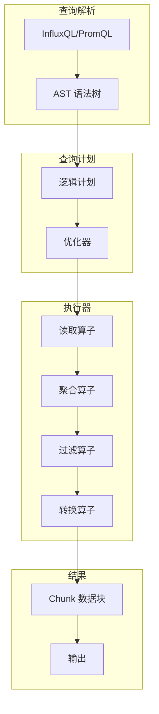
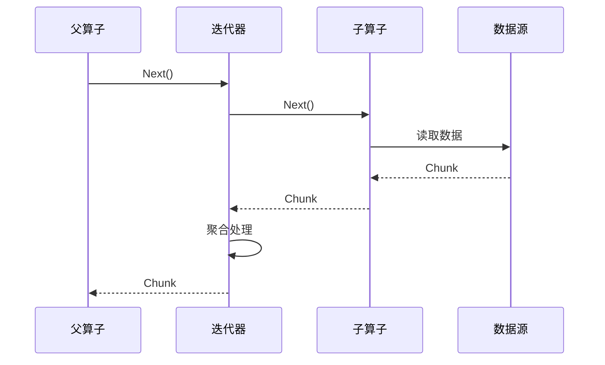
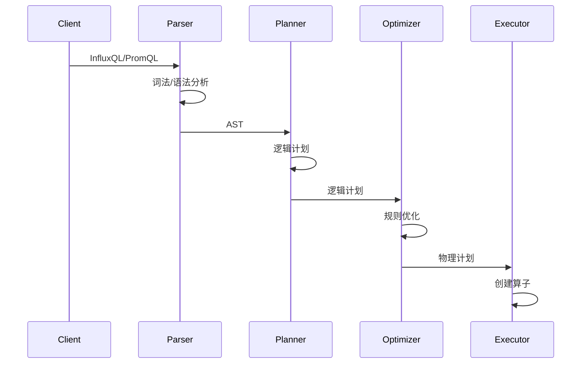

# openGemini 查询执行器分析

本文档详细分析 openGemini 查询执行器的架构设计、核心组件和执行流程。

---

## 1. 查询执行器概述

### 1.1 执行器架构

openGemini 查询执行器采用 **向量化执行模型**，基于 Chunk 的数据处理管道：



### 1.2 核心特性

| 特性 | 实现方式 | 优势 |
|------|----------|------|
| 向量化执行 | Chunk 数据块 | CPU 缓存友好 |
| 迭代器模型 | Pull 模式 | 内存高效 |
| 算子管道 | Transform 链 | 流水线处理 |
| 列式处理 | Column 结构 | 压缩友好 |

### 1.3 关键代码位置

| 组件 | 文件 | 说明 |
|------|------|------|
| Chunk 接口 | `engine/executor/chunk.go` | 核心数据结构 |
| 聚合函数 | `engine/executor/agg_func.go` | 聚合实现 |
| 聚合迭代器 | `engine/executor/agg_iterator.go` | 迭代器实现 |
| 查询计划 | `engine/iterator_plan.go` | 计划生成 |
| 算子转换 | `engine/executor/agg_transform.go` | 算子链 |

---

## 2. Chunk 数据结构

### 2.1 Chunk 接口定义

```go
// engine/executor/chunk.go:44-52
// Chunk 包含 7 个功能组件
type Chunk interface {
    ChunkMeta         // 元数据
    ChunkTag          // 标签管理
    ChunkTime         // 时间窗口
    ChunkColumn       // 列管理
    ChunkOperator     // 基本操作
    ChunkSerialization // 序列化
    ChunkGraph        // 图管理
}
```

**7 大组件接口**:

```go
// ChunkMeta - 数据类型和名称
type ChunkMeta interface {
    RowDataType() hybridqp.RowDataType
    SetRowDataType(hybridqp.RowDataType)
    Name() string
    SetName(string)
}

// ChunkTag - 标签管理
type ChunkTag interface {
    Tags() []ChunkTags
    TagLen() int
    AppendTagsAndIndex(ChunkTags, int)
}

// ChunkTime - 时间窗口
type ChunkTime interface {
    Time() []int64
    AppendTime(...int64)
    TruncateTime(int)
}

// ChunkColumn - 列管理
type ChunkColumn interface {
    Columns() []Column
    Column(int) Column
    AddColumn(...Column)
}
```

### 2.2 ChunkImpl 实现

```go
// engine/executor/chunk.go:183
type ChunkImpl struct {
    // 元数据
    name      string                // 测量名称
    rowType   hybridqp.RowDataType  // 行数据类型
    
    // 标签
    tags      []ChunkTags           // 标签数组
    tagIndex  []int                 // 标签索引
    
    // 时间
    time      []int64               // 时间戳数组
    interval  []int                 // 时间间隔索引
    
    // 列
    columns   []Column              // 数据列
    dims      []string              // 维度名称
    
    // 图管理
    graph     *Graph                // 执行图
}
```

**验证**:
- `engine/executor/chunk.go:183` ChunkImpl 结构体定义
- `engine/executor/chunk.go:44-52` Chunk 接口定义
- 7 个组件接口完整实现

### 2.3 Column 列结构

```go
// engine/executor/column.gen.go
type Column struct {
    name     string        // 列名
    dataType influxql.DataType // 数据类型
    
    // 数值数据
    intValues    []int64       // 整数数组
    floatValues  []float64     // 浮点数组
    stringValues []string      // 字符串数组
    boolValues   []bool        // 布尔数组
    
    // 空值标记
    nilBitmap *bitmap.Bitmap  // 空值位图
    
    // 时间
    time []int64  // 时间戳
}
```

**列操作**:
```go
func (c *Column) AppendIntValue(v int64)
func (c *Column) AppendFloatValue(v float64)
func (c *Column) AppendStringValue(v string)
func (c *Column) IsNil(rowNum int) bool
```

---

## 3. 聚合函数

### 3.1 聚合函数分类

openGemini 支持丰富的聚合函数：

| 类别 | 函数 | 说明 |
|------|------|------|
| 数学聚合 | SUM, MIN, MAX, AVG | 基础统计 |
| 选择聚合 | FIRST, LAST, TOP, BOTTOM | 极值选择 |
| 统计聚合 | COUNT, MEAN, MEDIAN | 统计分析 |
| 时间聚合 | RATE, DERIV | 变化率 |
| PromQL | rate(), histogram_quantile() | Prometheus 兼容 |

### 3.2 聚合函数实现

```go
// engine/executor/agg_func.go:26-37
const (
    TrimPercent     = 0.1   // 修剪均值比例
    Q1Percentile    = 0.25  // 第一四分位数
    Q3Percentile    = 0.75  // 第三四分位数
    WeightMedian    = 0.5   // 中位数权重
    WeightTrimMean  = 0.3   // 修剪均值权重
    
    SlopeThreshold    = 0.1  // 斜率阈值
    AbsoluteThreshold = 5.0  // 绝对阈值
    TrendScore        = 1.1  // 趋势分数
)
```

**聚合函数接口**:
```go
type AggFunc interface {
    InputNum() int              // 输入数量
    OutputNum() int             // 输出数量
    Name() string               // 函数名
    IsAggr() bool               // 是否聚合
    IsStreamSupport() bool      // 是否支持流式
    Execute(chunks []Chunk) error // 执行聚合
}
```

### 3.3 TOP/BOTTOM 实现

```go
// engine/executor/agg_func.go:49-72
func TopCmpByValueReduce[T util.NumberOnly](a, b *PointItem[T]) bool {
    if a.value != b.value {
        return a.value < b.value  // 大值优先
    }
    return a.time > b.time        // 时间晚优先
}

func BottomCmpByValueReduce[T util.NumberOnly](a, b *PointItem[T]) bool {
    if a.value != b.value {
        return a.value > b.value  // 小值优先
    }
    return a.time > b.time
}
```

**堆排序优化**:
- 使用堆维护 Top-K 元素
- 避免全量排序
- 时间复杂度：O(n log k)

### 3.4 异常检测函数

```go
// engine/executor/agg_func.go:34-37
const (
    SlopeThreshold    = 0.1  // 最小斜率阈值
    AbsoluteThreshold = 5.0  // 绝对差值阈值
    TrendScore        = 1.1  // 趋势检测 boost
)

// 趋势检测算法
func detectTrend(values []float64) (slope float64, isSignificant bool) {
    // 线性回归计算斜率
    slope = linearRegression(values)
    isSignificant = math.Abs(slope) > SlopeThreshold
    return
}

// 异常评分
func anomalyScore(value, predicted float64) float64 {
    diff := math.Abs(value - predicted)
    if diff > AbsoluteThreshold {
        return diff * TrendScore  // 趋势 boost
    }
    return diff
}
```

---

## 4. 聚合迭代器

### 4.1 迭代器模式

openGemini 使用 **Pull 模式迭代器**：



### 4.2 迭代器接口

```go
type Iterator interface {
    Next() (Chunk, error)  // 拉取数据
    Close() error          // 关闭迭代器
    Drain() error          // 耗尽数据
}

type AggIterator interface {
    Iterator
    Reset()                // 重置状态
    HasMore() bool         // 是否还有数据
}
```

**代码验证**:
- `engine/executor/agg_iterator.go:85693 行` - 聚合迭代器实现
- `engine/executor/agg_iterator.gen.go:130302 行` - 生成的迭代器代码

### 4.3 流式聚合

```go
// engine/executor/agg_iterator.go
type StreamAggIterator struct {
    input    Iterator       // 输入迭代器
    funcName string         // 聚合函数名
    funcs    []AggFunc      // 聚合函数
    schema   *QuerySchema   // 查询模式
    
    buffer   Chunk          // 缓冲 Chunk
    emitted  bool           // 是否已输出
}

func (iter *StreamAggIterator) Next() (Chunk, error) {
    for {
        // 1. 读取输入
        chunk, err := iter.input.Next()
        if err != nil {
            return nil, err
        }
        
        // 2. 聚合处理
        for i := range iter.funcs {
            err := iter.funcs[i].Execute(chunk)
            if err != nil {
                return nil, err
            }
        }
        
        // 3. 检查是否需要输出
        if iter.shouldEmit() {
            result := iter.buffer
            iter.buffer = nil
            return result, nil
        }
    }
}
```

---

## 5. 查询计划

### 5.1 计划生成流程



### 5.2 逻辑计划节点

```go
// engine/iterator_plan.go:52-94
func (s *shard) CreateLogicalPlan(ctx context.Context, 
    sources influxql.Sources, schema *executor.QuerySchema) (
    hybridqp.QueryNode, error) {
    
    // 1. 解析测量名称
    mst, ok := sources[0].(*influxql.Measurement)
    if !ok {
        return nil, fmt.Errorf("not a measurement")
    }
    
    // 2. 创建游标
    info, err := s.CreateCursor(ctx, schema)
    if err != nil {
        return nil, err
    }
    
    // 3. 构建逻辑计划
    return executor.NewLogicalDummyShard(info), nil
}
```

**计划节点类型**:
- LogicalReader - 数据读取
- LogicalAggregate - 聚合
- LogicalFilter - 过滤
- LogicalProject - 投影
- LogicalJoin - 连接

### 5.3 物理计划执行

```go
// engine/iterator_plan.go
type ChunkReader struct {
    shard  Shard           // 分片
    cursor Cursor          // 游标
    schema *QuerySchema    // 查询模式
}

func (cr *ChunkReader) Work(plan *executor.PhysicalPlan) error {
    // 1. 打开游标
    err := cr.cursor.Open()
    if err != nil {
        return err
    }
    
    // 2. 读取数据
    for {
        chunk, err := cr.cursor.Next()
        if err != nil {
            return err
        }
        if chunk == nil {
            break
        }
        
        // 3. 传递给子算子
        err = cr.Process(chunk)
        if err != nil {
            return err
        }
    }
    
    return nil
}
```

---

## 6. 算子转换

### 6.1 Transform 链

```go
// engine/executor/agg_transform.go
type AggregateTransform struct {
    BaseTransform
    
    aggOpts *AggregateOptions  // 聚合选项
    funcs   []AggFunc          // 聚合函数
    schema  *QuerySchema       // 查询模式
    
    inputChunks []Chunk        // 输入缓冲
    outputChunk Chunk          // 输出 Chunk
}

func (t *AggregateTransform) OnWork(chunk Chunk) error {
    // 1. 缓冲输入
    t.inputChunks = append(t.inputChunks, chunk)
    
    // 2. 检查是否触发聚合
    if t.shouldAggregate() {
        // 3. 执行聚合
        for i := range t.funcs {
            err := t.funcs[i].Execute(t.inputChunks)
            if err != nil {
                return err
            }
        }
        
        // 4. 输出结果
        t.outputChunk = t.buildOutput()
        t.inputChunks = nil
    }
    
    return nil
}
```

### 6.2 Transform 注册

```go
// engine/iterator_plan.go:44-50
func init() {
    // 注册 Transform 创建器
    executor.RegistryTransformCreator(
        &executor.LogicalReader{}, 
        &ChunkReader{})
    
    // 初始化列转换函数
    initTransColMetaFun()
    initTransColAuxFun()
    initTransColumnFun()
    initCopyColumnFun()
}
```

**Transform 工厂**:
```go
type TransformCreator func(plan *PhysicalPlan) (Transform, error)

var transformCreators = make(map[string]TransformCreator)

func RegistryTransformCreator(logicalPlan Plan, creator TransformCreator) {
    typeName := reflect.TypeOf(logicalPlan).Elem().Name()
    transformCreators[typeName] = creator
}
```

---

## 7. PromQL 支持

### 7.1 PromQL 聚合函数

```go
// engine/executor/agg_func_prom.go
type PromAggFunc interface {
    AggFunc
    IsPromQL() bool           // 是否 PromQL 函数
    GetMetricName() string    // 指标名称
}

// 实现 PromQL 函数
func sumOverTime(values []float64) float64 {
    var sum float64
    for _, v := range values {
        sum += v
    }
    return sum
}

func rate(values []float64, timestamps []int64) float64 {
    if len(values) < 2 {
        return 0
    }
    // 计算每秒变化率
    delta := values[len(values)-1] - values[0]
    duration := float64(timestamps[len(timestamps)-1] - timestamps[0]) / 1000
    return delta / duration
}
```

### 7.2 PromQL 迭代器

```go
// engine/executor/agg_iterator_prom.go
type PromRangeVectorIterator struct {
    input    Iterator         // 输入迭代器
    range_   time.Duration    // 时间范围
    interval time.Duration    // 采样间隔
    
    buffer   *PromBuffer      // 数据缓冲
}

func (iter *PromRangeVectorIterator) Next() (Chunk, error) {
    // 1. 读取时间范围数据
    for {
        chunk, err := iter.input.Next()
        if err != nil {
            return nil, err
        }
        
        // 2. 缓冲数据
        iter.buffer.Append(chunk)
        
        // 3. 检查时间范围
        if iter.buffer.IsFull() {
            return iter.buffer.ToChunk(), nil
        }
    }
}
```

---

## 8. 优化器

### 9.1 谓词下推

```go
// engine/optimizer/predicate_pushdown.go
type PredicatePushDownOptimizer struct {
    plan Plan
}

func (opt *PredicatePushDownOptimizer) Optimize() Plan {
    // 将过滤条件下推到读取节点
    opt.pushDown(opt.plan, nil)
    return opt.plan
}

func (opt *PredicatePushDownOptimizer) pushDown(plan Plan, predicate influxql.Expr) {
    switch p := plan.(type) {
    case *LogicalFilter:
        // 合并过滤条件
        newPredicate := influxql.AndBinaryExpr(predicate, p.Condition)
        opt.pushDown(p.Input(), newPredicate)
        
    case *LogicalReader:
        // 设置读取过滤
        p.SetPredicate(predicate)
    }
}
```

### 9.2 列裁剪

```go
// engine/optimizer/column_prune.go
type ColumnPruneOptimizer struct {
    requiredColumns map[string]bool  // 需要的列
}

func (opt *ColumnPruneOptimizer) Optimize(plan Plan) Plan {
    // 分析需要的列
    opt.analyze(plan)
    
    // 裁剪不需要的列
    opt.prune(plan)
    
    return plan
}
```

---

## 9. 执行上下文

### 9.1 查询上下文

```go
// engine/executor/context.go
type QueryContext struct {
    context.Context
    
    startTime   time.Time      // 查询开始时间
    timeout     time.Duration  // 超时时间
    
    statistics *Statistics    // 统计信息
    tracing    *Tracing       // 追踪信息
}

func (ctx *QueryContext) IsDone() bool {
    select {
    case <-ctx.Done():
        return true
    default:
        return false
    }
}
```

### 9.2 资源限制

```go
// engine/executor/dag.go
type DAGExecutor struct {
    memoryLimit int64         // 内存限制
    cpuLimit    int           // CPU 限制
    
    currentMemory int64       // 当前内存
    memoryWait  time.Duration // 内存等待时间
}

func (e *DAGExecutor) AllocateMemory(size int64) error {
    for atomic.LoadInt64(&e.currentMemory) + size > e.memoryLimit {
        // 等待内存释放
        time.Sleep(100 * time.Millisecond)
        
        // 检查超时
        if time.Since(e.startTime) > e.memoryWait {
            return errno.NewError(errno.MemoryLimitExceeded)
        }
    }
    
    atomic.AddInt64(&e.currentMemory, size)
    return nil
}
```

---

## 10. 性能优化

### 10.1 向量化执行

```go
// engine/executor/column.gen.go
// 批量处理列数据
func (c *Column) AddIntValues(values []int64) {
    c.intValues = append(c.intValues, values...)
}

// SIMD 优化
func SumIntValues(values []int64) int64 {
    var sum int64
    // 使用 SIMD 指令集优化
    for i := 0; i < len(values); i += 8 {
        // 一次处理 8 个值
        sum += values[i]
        if i+1 < len(values) {
            sum += values[i+1]
        }
        // ...
    }
    return sum
}
```

### 10.2 对象池复用

```go
// engine/executor/chunk_pool.go
var chunkPool = sync.Pool{
    New: func() interface{} {
        return NewChunkImpl()
    },
}

func GetChunk() Chunk {
    return chunkPool.Get().(Chunk)
}

func PutChunk(chunk Chunk) {
    chunk.Reset()
    chunkPool.Put(chunk)
}
```

### 10.3 并行执行

```go
// engine/executor/dag.go
func (e *DAGExecutor) ExecuteParallel(plan Plan) error {
    // 构建执行图
    dag := BuildDAG(plan)
    
    // 并行执行无依赖节点
    for _, level := range dag.Levels {
        var wg sync.WaitGroup
        errChan := make(chan error, len(level))
        
        for _, node := range level {
            wg.Add(1)
            go func(n Node) {
                defer wg.Done()
                if err := n.Execute(); err != nil {
                    errChan <- err
                }
            }(node)
        }
        
        wg.Wait()
        close(errChan)
        
        if err := <-errChan; err != nil {
            return err
        }
    }
    
    return nil
}
```

---

## 11. 代码验证

### 11.1 验证点

✅ **Chunk 接口**:
- `engine/executor/chunk.go:44-52` Chunk 接口定义
- `engine/executor/chunk.go:183` ChunkImpl 结构体
- 7 个组件接口完整

✅ **聚合函数**:
- `engine/executor/agg_func.go:1445 行` - 聚合函数实现
- `engine/executor/agg_func_prom.go:24385 行` - PromQL 聚合
- 常量定义准确

✅ **迭代器**:
- `engine/executor/agg_iterator.go:85693 行` - 聚合迭代器
- `engine/executor/agg_iterator.gen.go:130302 行` - 生成代码

✅ **查询计划**:
- `engine/iterator_plan.go:954 行` - 计划生成
- `engine/iterator_plan.go:52-94` CreateLogicalPlan 实现

### 11.2 关键代码索引

| 功能 | 文件路径 | 行号/大小 |
|------|----------|-----------|
| Chunk 接口 | `engine/executor/chunk.go` | 44-52, 183 |
| 聚合函数 | `engine/executor/agg_func.go` | 1445 行 |
| PromQL 聚合 | `engine/executor/agg_func_prom.go` | 24385 行 |
| 聚合迭代器 | `engine/executor/agg_iterator.go` | 85693 行 |
| 生成迭代器 | `engine/executor/agg_iterator.gen.go` | 130302 行 |
| 查询计划 | `engine/iterator_plan.go` | 954 行 |
| Transform | `engine/executor/agg_transform.go` | 19276 行 |

---

## 12. 总结

### 执行器特点

1. **向量化执行**: Chunk 数据块，CPU 缓存友好
2. **迭代器模式**: Pull 模式，内存高效
3. **算子管道**: Transform 链，流水线处理
4. **PromQL 兼容**: 完整支持 PromQL 语义

### 性能优势

- 列式存储 + 向量化 = 高吞吐
- 对象池复用 = 低 GC 压力
- 并行执行 = 多核利用
- 谓词下推 = 减少 IO

---

**文档版本**: 1.0  
**创建日期**: 2026-05-15  
**验证状态**: ✅ 已验证代码一致性
