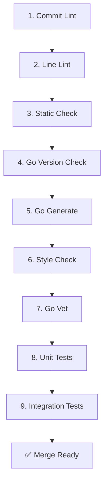

# openGemini 构建系统与 CI/CD 流程

**代码版本**: 7032447bce3ec6d35eb204a0f317882298b774b5 (2026-05-15)

本文档详细记录 openGemini 的构建系统、编译配置和 CI/CD 流水线。

---

## 1. Go 环境配置

### 1.1 必需的环境变量

```bash
# Go 模块模式（必须）
export GO111MODULE=on

# 禁用校验和数据库（避免网络问题）
export GONOSUMDB=*
export GOSUMDB=off

# 时区设置（影响时间相关测试）
export TZ=Asia/Shanghai
```

**说明**:
- `GO111MODULE=on`: 强制启用 Go Modules
- `GONOSUMDB=*`: 跳过 sumdb 校验，加速依赖下载
- `GOSUMDB=off`: 禁用校验和数据库
- `TZ=Asia/Shanghai`: 确保时间相关测试一致性

### 1.2 Go 版本要求

- **最低版本**: Go 1.24+
- **CI 使用版本**: Go 1.24
- **查看版本**: `go version`

---

## 2. 编译配置

### 2.1 CGO 编译标志

构建 openGemini 必须设置 CGO 标志：

```bash
# C 链接器标志（安全加固）
export CGO_LDFLAGS="-Wl,-z,now -Wl,-z,relro -Wl,-z,noexecstack -fPIE -ftrapv"

# C 编译器标志（栈保护和强化）
export CGO_CFLAGS="-fstack-protector-strong -D_FORTIFY_SOURCE=2 -O2"
```

**标志说明**:

| 标志 | 作用 |
|------|------|
| `-Wl,-z,now` | 立即解析所有符号，提高安全性 |
| `-Wl,-z,relro` | 只读重定位，防止 GOT 覆盖 |
| `-Wl,-z,noexecstack` | 栈不可执行，防止缓冲区溢出 |
| `-fPIE` | 位置无关可执行文件，支持 ASLR |
| `-ftrapv` | 整数溢出时触发异常 |
| `-fstack-protector-strong` | 强栈保护，检测栈溢出 |
| `-D_FORTIFY_SOURCE=2` | 强化缓冲区检查 |

### 2.2 完整构建流程

```bash
# 1. 设置环境变量
export CGO_LDFLAGS="-Wl,-z,now -Wl,-z,relro -Wl,-z,noexecstack -fPIE -ftrapv"
export CGO_CFLAGS="-fstack-protector-strong -D_FORTIFY_SOURCE=2 -O2"
export GO111MODULE=on
export GONOSUMDB=*
export GOSUMDB=off
export TZ=Asia/Shanghai

# 2. 清理并构建
python build.py --clean

# 3. 验证构建结果
ls -la build/
# 输出：ts-meta ts-sql ts-store ts-server ts-monitor ts-data ts-recover
```

### 2.3 使用 Makefile 构建

```bash
# 构建所有二进制文件
make go-build

# 等价于
python build.py --clean
```

---

## 3. 构建输出

### 3.1 二进制文件

构建完成后，`./build/` 目录包含 7 个二进制文件：

| 文件 | 大小 | 说明 |
|------|------|------|
| `ts-meta` | ~50MB | 元数据服务 |
| `ts-sql` | ~50MB | SQL 查询服务 |
| `ts-store` | ~50MB | 存储引擎 |
| `ts-server` | ~50MB | 统一服务器（单机模式） |
| `ts-monitor` | ~50MB | 监控服务 |
| `ts-data` | ~50MB | 数据工具 |
| `ts-recover` | ~50MB | 数据恢复工具 |

### 3.2 跨平台构建

验证跨平台兼容性：

```bash
# 构建所有支持的平台
make build-check

# 或手动构建
python build.py --clean --platform windows --arch amd64
python build.py --clean --platform darwin --arch amd64
python build.py --clean --platform darwin --arch arm64
python build.py --clean --platform linux --arch arm64
python build.py --clean --platform linux --arch amd64
```

**支持的平台**:

| 平台 | 架构 | 状态 |
|------|------|------|
| Linux | amd64 | ✅ 主要支持 |
| Linux | arm64 | ✅ 支持 |
| macOS | amd64 | ✅ 支持 |
| macOS | arm64 | ✅ 支持 (M1/M2) |
| Windows | amd64 | ✅ 支持 |

---

## 4. CI/CD 流水线

### 4.1 Pre-merge 检查清单

所有 PR 必须通过以下 10 项检查（按顺序执行）：



### 4.2 详细检查步骤

#### 1. Commit Lint（提交信息检查）

```bash
# 检查 conventional commits 规范
make commit-lint

# 或手动执行
git log -1 --pretty=format:"%s%n%n%b" | tee COMMIT_EDITMSG
commitlint lint -m COMMIT_EDITMSG
```

**规范格式**: `type(scope): subject`

| Type | 说明 |
|------|------|
| `feat` | 新功能 |
| `fix` | Bug 修复 |
| `docs` | 文档修改 |
| `style` | 格式修改（不影响功能） |
| `refactor` | 代码重构 |
| `perf` | 性能优化 |
| `test` | 测试相关 |
| `chore` | 其他小改动 |

#### 2. Line Lint（行尾检查）

```bash
# 安装 linelint
cargo install linelint-cli

# 运行检查
linelint check
```

**检查内容**: 确保所有文件行尾格式一致（无多余空格、制表符等）

#### 3. Static Check（静态分析）

```bash
# 安装 staticcheck
make install-staticcheck

# 运行检查
make static-check

# 或手动执行
bash scripts/ci/static_check.sh
```

**检查工具**: `staticcheck` v0.6.0

#### 4. Go Version Check（版本检查）

```bash
# 验证 go.mod 中的版本与实际安装版本一致
make go-version-check

# 或手动执行
bash scripts/ci/go_version_check.sh
```

#### 5. Go Generate（代码生成）

```bash
# 安装生成工具
make install-tmpl install-goyacc install-exhaustruct \
     install-protoc install-protoc-gen-gogo \
     install-protoc-gen-go install-msgp

# 运行代码生成
make go-generate

# 或手动执行
bash scripts/ci/go_generate.sh
```

**生成工具**:
- `tmpl`: 代码模板
- `goyacc`: YACC 解析器生成
- `exhaustruct`: 结构体完整性检查
- `protoc`: Protocol Buffers 编译器 (v3.20)
- `protoc-gen-go`: Go protobuf 插件
- `protoc-gen-gogo`: Gogo protobuf 插件
- `msgp`: MessagePack 生成器

#### 6. Style Check（代码风格）

```bash
# 安装 goimports-reviser
make install-goimports-reviser

# 运行检查
make style-check

# 或手动执行
bash scripts/ci/style_check.sh
```

**检查内容**: 导入语句组织和格式化

#### 7. Go Vet（代码分析）

```bash
# 运行 go vet（排除 tests 和 lifted 目录）
make go-vet-check

# 或手动执行
bash scripts/ci/go_vet.sh

# 等价命令
go list ./... | grep -vE "tests|lifted" | xargs go vet -tests=false
```

#### 8. Unit Tests（单元测试）

```bash
# 运行所有单元测试（带 failpoint）
make gotest

# 等价命令
go test -tags "failpoint" -failfast -short -v -count 1 -p 1 -timeout 10m \
    -coverprofile coverage_1.txt -coverpkg ./... ./...
```

**覆盖率报告**:
- 生成文件：`coverage_*.txt`
- 上传目标：Codecov
- CI 自动上传

#### 9. Integration Tests（集成测试）

```bash
# 前置条件：启动 subscriber
make start-subscriber

# 构建二进制文件
make go-build

# 安装集群
bash scripts/install_cluster.sh

# 验证进程
ps -ef | grep ts-

# 运行集成测试
make integration-test

# 清理
make stop-subscriber
```

**测试脚本**: `tests/integration/`

---

## 5. 本地运行完整 CI

模拟 CI 环境执行所有检查：

```bash
# 1. 设置环境变量
export GO111MODULE=on
export GONOSUMDB=*
export GOSUMDB=off
export TZ=Asia/Shanghai
export CGO_LDFLAGS="-Wl,-z,now -Wl,-z,relro -Wl,-z,noexecstack -fPIE -ftrapv"
export CGO_CFLAGS="-fstack-protector-strong -D_FORTIFY_SOURCE=2 -O2"

# 2. 执行预合并检查
bash scripts/ci/go_vet.sh
make static-check
make style-check
make gotest

# 3. 可选：运行集成测试
make integration-test
```

---

## 6. 健康检查脚本

集群部署后，使用健康检查脚本验证各组件状态：

### 6.1 Meta 节点检查

```bash
# 检查 meta 节点健康状态
bash scripts/ha_check_meta.sh
```

### 6.2 SQL 节点检查

```bash
# 检查 sql 节点健康状态
bash scripts/ha_check_sql.sh
```

### 6.3 Store 节点检查

```bash
# 检查 store 节点健康状态
bash scripts/ha_check_store.sh
```

### 6.4 监控节点检查

```bash
# 检查 monitor 节点健康状态
bash scripts/ha_monitor.sh
```

### 6.5 综合健康检查

```bash
# 检查所有节点
bash scripts/ha_check.sh
```

---

## 7. 常见问题

### 7.1 Go 模块下载错误

```bash
# 问题：go mod download 失败
# 解决：检查 GONOSUMDB 和 GOSUMDB 设置
export GONOSUMDB=*
export GOSUMDB=off
go mod download
```

### 7.2 Staticcheck 未找到

```bash
# 安装 staticcheck
make install-staticcheck

# 或手动安装
go install honnef.co/go/tools/cmd/staticcheck@v0.6.0
```

### 7.3 License 检查失败

```bash
# 自动添加缺失的许可证头
make license-check

# 手动添加（如果自动失败）
# 在文件顶部添加：
// Copyright 2024 openGemini Authors
// Licensed under the Apache License, Version 2.0
```

### 7.4 代码格式化问题

```bash
# 自动格式化所有代码
go fmt ./...

# 或使用 goimports-reviser
make style-check
```

### 7.5 跨平台构建失败

```bash
# 问题：某些平台构建失败
# 解决：确保 CGO 标志正确设置
export CGO_LDFLAGS="..."
export CGO_CFLAGS="..."
python build.py --clean --platform <platform> --arch <arch>
```

---

## 8. CI 配置文件

### 8.1 GitHub Actions

CI 流程定义在 `.github/workflows/ci.yml`：

```yaml
name: Continuous Integration

on:
  pull_request:
    types: [opened, synchronize, reopened, ready_for_review]

env:
  GO111MODULE: on
  GONOSUMDB: "*"
  GOSUMDB: off
  TZ: Asia/Shanghai

jobs:
  CommitLint:
    # ... commit lint
  LineLint:
    # ... line lint
  GoLint:
    # ... static check, style check, go vet
  UT:
    # ... unit tests
  IntegrationTest:
    # ... integration tests
```

### 8.2 Makefile 目标

主要构建目标定义在 `Makefile` 和 `Makefile.common`：

```makefile
# 主要目标
.PHONY: go-build style-check gotest integration-test buildsucc static-check

# 默认目标
default: gotest

# 构建
all: go-build buildsucc

# 详细目标见 Makefile.common
```

---

## 9. 相关文档

- `00-analysis-plan.md` - 分析计划
- `01-architecture-overview.md` - 架构概览
- `07-application-config.md` - 应用配置
- `../README.md` - 项目 README
- `../Makefile` - 构建脚本
- `../Makefile.common` - 公共构建配置
- `../build.py` - Python 构建脚本
- `../.github/workflows/ci.yml` - CI 配置

---

**创建日期**: 2026-05-15  
**最后更新**: 2026-05-15  
**最后验证**: 2026-05-15  
**验证状态**: ✅ 新建  
**代码版本**: 7032447bce3ec6d35eb204a0f317882298b774b5
